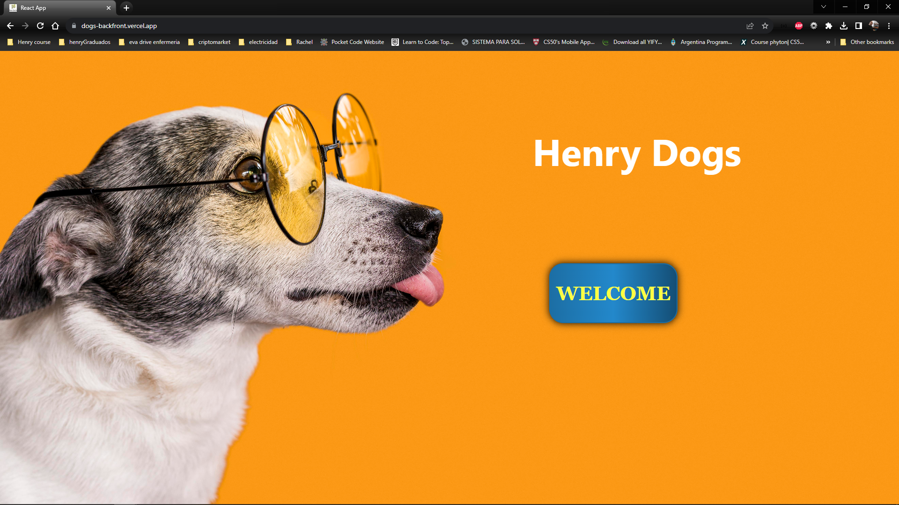
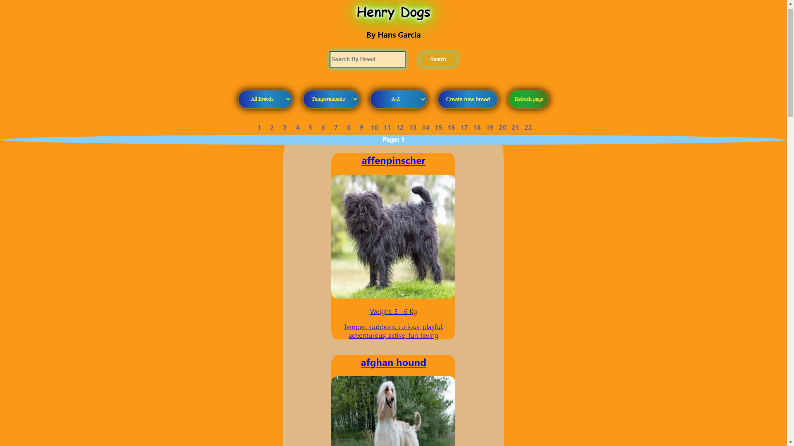
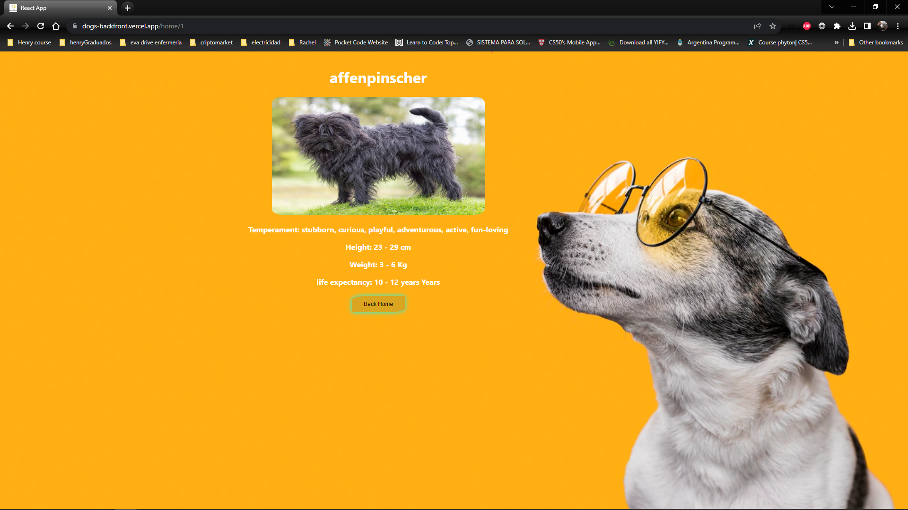
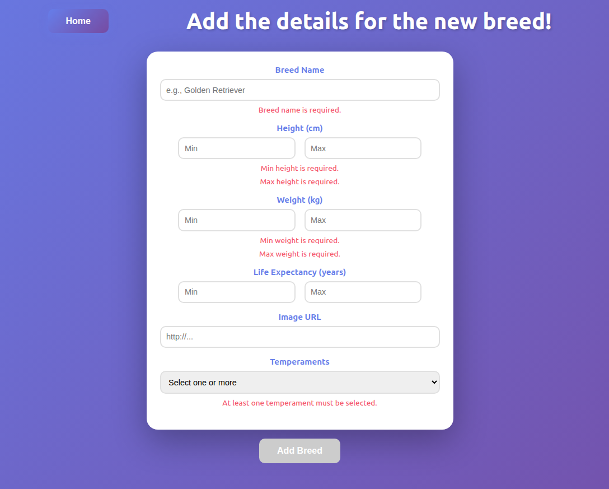

# Henry Dogs 🐕

**Live demo / Demo en vivo:** https://client-dogs.netlify.app

Application to browse dog breeds with their relevant information, using [The Dog API](https://thedogapi.com/) together with a local PostgreSQL database.

Aplicación para explorar razas de perros con su información relevante, usando [The Dog API](https://thedogapi.com/) junto con una base de datos PostgreSQL local.

## Screenshots / Capturas

| Landing | Home |
| --- | --- |
|  |  |

| Detail / Detalle | New breed / Nueva raza |
| --- | --- |
|  |  |

---

## 🇬🇧 English

### Features

- Browse dog breeds with image, name, temperament and weight.
- Search breeds by name.
- Filter by temperament and by origin (from the external API or created by users).
- Sort alphabetically or by weight, ascending or descending.
- Pagination: 8 breeds per page, with a page selector and previous/next arrows.
- Breed detail page with height, weight and life span.
- Form to create a new breed, validated in JavaScript, with one or more temperaments.

### Tech stack

- **Frontend:** React, Redux, React Router, Axios, CSS Modules
- **Backend:** Node.js, Express, Sequelize
- **Database:** PostgreSQL

### Running it locally

**Requirements:** Node.js 12.18.3 or newer, npm 6.14.6 or newer, and PostgreSQL.

1. **Database:** create a database called `dogs` in PostgreSQL.
2. **API:**
   ```sh
   cd api
   npm install
   cp .env.example .env   # then fill in your values
   npm start              # runs on http://localhost:3001
   ```
3. **Client:** in another terminal:
   ```sh
   cd client
   npm install
   npm start              # opens http://localhost:3000
   ```

### Environment variables

`api/.env` (see `api/.env.example`):

| Variable | Description |
| --- | --- |
| `API_KEY` | Your key for The Dog API (get one at thedogapi.com). |
| `DB_USER` / `DB_PASSWORD` / `DB_HOST` | PostgreSQL credentials for local development. |
| `DATABASE_URL` | Full PostgreSQL connection string. Used in production instead of the `DB_*` variables. |

`client/.env` (see `client/.env.example`):

| Variable | Description |
| --- | --- |
| `REACT_APP_API_URL` | Base URL of the API, for example `http://localhost:3001/api`. |

---

## 🇪🇸 Español

### Funcionalidades

- Ver razas de perros con imagen, nombre, temperamento y peso.
- Buscar razas por nombre.
- Filtrar por temperamento y por origen (de la API externa o creadas por el usuario).
- Ordenar alfabéticamente o por peso, de forma ascendente o descendente.
- Paginado: 8 razas por página, con selector de página y flechas anterior/siguiente.
- Página de detalle con altura, peso y años de vida.
- Formulario para crear una nueva raza, validado con JavaScript, con uno o más temperamentos.

### Tecnologías

- **Frontend:** React, Redux, React Router, Axios, CSS Modules
- **Backend:** Node.js, Express, Sequelize
- **Base de datos:** PostgreSQL

### Cómo ejecutarlo localmente

**Requisitos:** Node.js 12.18.3 o superior, npm 6.14.6 o superior, y PostgreSQL.

1. **Base de datos:** crea una base llamada `dogs` en PostgreSQL.
2. **API:**
   ```sh
   cd api
   npm install
   cp .env.example .env   # y completa tus valores
   npm start              # corre en http://localhost:3001
   ```
3. **Cliente:** en otra terminal:
   ```sh
   cd client
   npm install
   npm start              # abre http://localhost:3000
   ```

### Variables de entorno

`api/.env` (ver `api/.env.example`):

| Variable | Descripción |
| --- | --- |
| `API_KEY` | Tu clave de The Dog API (se obtiene en thedogapi.com). |
| `DB_USER` / `DB_PASSWORD` / `DB_HOST` | Credenciales de PostgreSQL para desarrollo local. |
| `DATABASE_URL` | Cadena de conexión completa de PostgreSQL. Se usa en producción en lugar de las variables `DB_*`. |

`client/.env` (ver `client/.env.example`):

| Variable | Descripción |
| --- | --- |
| `REACT_APP_API_URL` | URL base de la API, por ejemplo `http://localhost:3001/api`. |

---

## 👨‍💻 Autor / Author

**Hans Rafael** — [@Hans-Rafael](https://github.com/Hans-Rafael) · [LinkedIn: hans-developer](https://www.linkedin.com/in/hans-developer/)
